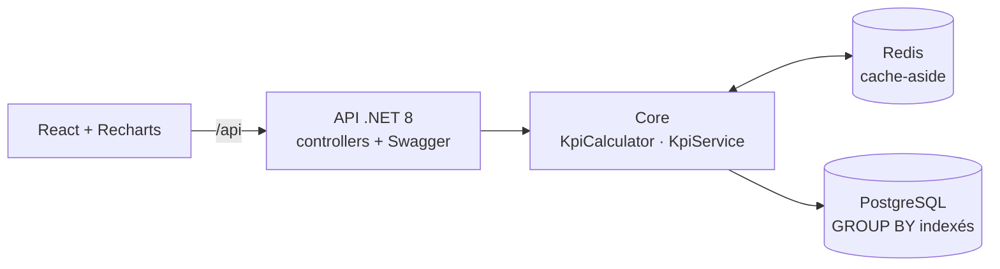

# RetailInsights — Pilotage de la performance des ventes

[](https://github.com/KarnasZiad/RetailInsights/actions/workflows/ci-cd.yml)


API **.NET 8** qui calcule les indicateurs de performance d'un réseau de magasins (chiffre d'affaires
par magasin, panier moyen, indice de vente, top produits, canaux de vente) avec un **cache Redis**,
un **tableau de bord React** avec graphiques, et une chaîne **CI/CD complète** : build, tests xUnit,
couverture de code, analyse SonarCloud, images Docker, puis déploiement sur **Azure Container Apps**.

## Indicateurs

| Indicateur | Définition | Endpoint |
|---|---|---|
| Chiffre d'affaires (CA) | Somme des montants encaissés (remises déduites) | `summary`, `stores`, `trend` |
| Tickets | Nombre de passages en caisse / commandes | `summary`, `stores` |
| Panier moyen | CA / tickets | `summary`, `stores`, `trend` |
| Indice de vente (UPT) | Articles / tickets | `summary`, `stores` |
| Prix moyen de vente | CA / articles | `summary` |
| Évolution | Variation en % vs la période précédente de même durée | `summary`, `stores` |
| Part du CA | Contribution d'un magasin, d'un produit ou d'un canal | `stores`, `top-products`, `channels` |
| Top produits | Classement par CA ou par unités | `top-products` |

Toutes les routes acceptent `from`, `to` (dates ISO, incluses) et `storeId` ; sans période, ce sont
les 30 derniers jours de données. Chaque réponse porte un en-tête `X-Cache: HIT | MISS`.

## Architecture



PostgreSQL agrège (`SUM`/`COUNT`/`GROUP BY` sur l'index `(business_date, store_id)`), le cœur
métier dérive les ratios, évolutions, parts et classements, et le résultat est mis en cache dans
Redis avec des **clés versionnées** : l'ingestion d'un ticket invalide tout le cache en une seule
écriture. Détails, séquences et décisions : **[docs/architecture.md](docs/architecture.md)**.

## Démarrer

```bash
docker compose up --build
```

| Service | URL |
|---|---|
| Tableau de bord | http://localhost:8080 |
| API + Swagger | http://localhost:5090/swagger |
| PostgreSQL / Redis | `localhost:5432` / `localhost:6379` |

Au premier démarrage, l'API applique les migrations EF Core et génère un historique de démonstration
(6 magasins, 16 produits, 180 jours, environ 30 000 tickets) avec une saisonnalité réaliste.

En développement : `docker compose up -d postgres redis`, puis `dotnet run --project src/RetailInsights.Api`
et `cd web && npm install && npm run dev` (http://localhost:5173).

### Exemples

```bash
curl -i "http://localhost:5090/api/kpis/summary?from=2026-09-01&to=2026-09-30"
curl    "http://localhost:5090/api/kpis/top-products?by=Units&top=5"
curl -X POST http://localhost:5090/api/sales -H 'Content-Type: application/json' -d '{
  "ticketNumber": "T-DEMO-1", "storeId": 1, "soldAt": "2026-09-30T15:00:00Z", "channel": "InStore",
  "lines": [{ "sku": "TSH-001", "quantity": 2 }]
}'
```

## Tableau de bord

- Filtres sur une seule ligne, au-dessus de tout : période (7, 30, 90, 180 jours ou dates libres) et magasin ; tous les chiffres utilisent la même sélection.
- Tuiles : CA en valeur principale, tickets, panier moyen, indice de vente, prix moyen, avec l'évolution (flèche + signe + couleur) vs la période précédente.
- Évolution du CA (jour, semaine ou mois), CA par magasin, top 10 produits (CA ou unités), répartition par canal.
- Chaque graphique a une info-bulle et une **vue tableau** ; la palette (validée pour le daltonisme, en clair et en sombre) et le mode sombre sont définis par des variables CSS.

## Tests et qualité

```bash
dotnet test                                     # Docker requis pour les tests d'intégration
dotnet test tests/RetailInsights.UnitTests      # tests unitaires seuls
```

- **Unitaires** (xUnit) : périodes et période de comparaison, ratios et divisions par zéro, évolutions et arrondis, classements, séries continues (jours sans vente à zéro), semaines ISO, ventilation par canal, comportement du cache (HIT/MISS, portée des clés, invalidation), validation et ingestion des ventes.
- **Intégration** (xUnit + Testcontainers) : l'API réelle sur PostgreSQL et Redis éphémères, avec un jeu de données dont chaque KPI est calculé à la main dans les tests ; mise en cache Redis puis invalidation après `POST /api/sales` ; health checks.
- **Couverture** : coverlet (Cobertura + OpenCover) ; résumé publié dans chaque exécution GitHub Actions, rapport HTML en artefact, envoyé à SonarCloud.

## CI/CD

Workflow [`.github/workflows/ci-cd.yml`](.github/workflows/ci-cd.yml) :

1. **build-test** : build, tests unitaires et d'intégration, couverture, analyse **SonarCloud** ;
2. **web** : build du tableau de bord ; **infra** : validation du Bicep ;
3. **docker** : images `retailinsights-api` et `retailinsights-web`, publiées sur GHCR depuis `main` (tag `sha-xxxxxxx` + `latest`) ;
4. **deploy** : connexion à Azure par **OIDC**, `az deployment group create` (infrastructure + nouvelle révision), smoke test sur `/health/ready`.

Sans configuration, SonarCloud et le déploiement sont simplement sautés : le pipeline reste vert.

### Activer SonarCloud

1. Importer le dépôt sur [sonarcloud.io](https://sonarcloud.io) et désactiver l'« Automatic Analysis ».
2. Dans *Settings → Secrets and variables → Actions* : secret `SONAR_TOKEN`, variables `SONAR_ORGANIZATION` et `SONAR_PROJECT_KEY`.

### Déploiement sur Azure Container Apps

```bash
az group create -n rg-retailinsights -l francecentral

# Identité de déploiement fédérée avec GitHub (OIDC)
az ad app create --display-name retailinsights-github
az ad sp create --id <appId>
az role assignment create --assignee <appId> --role Contributor \
  --scope /subscriptions/<subscriptionId>/resourceGroups/rg-retailinsights
az ad app federated-credential create --id <appId> --parameters '{
  "name": "github-main", "issuer": "https://token.actions.githubusercontent.com",
  "subject": "repo:KarnasZiad/RetailInsights:environment:production",
  "audiences": ["api://AzureADTokenExchange"] }'
```

Puis dans GitHub : variables `AZURE_CLIENT_ID`, `AZURE_TENANT_ID`, `AZURE_SUBSCRIPTION_ID`,
`AZURE_RESOURCE_GROUP`, secrets `POSTGRES_ADMIN_PASSWORD` et, si les packages GHCR restent privés,
`GHCR_PULL_TOKEN` (PAT `read:packages`). Le prochain push sur `main` crée l'infrastructure
([`infra/main.bicep`](infra/main.bicep)) : Log Analytics, environnement Container Apps,
PostgreSQL Flexible Server, l'API (avec Redis en sidecar) et le front.

> Coût indicatif : PostgreSQL B1ms facturé en continu, Container Apps à la consommation.
> `az group delete -n rg-retailinsights` supprime tout.

## Structure

```
src/
  RetailInsights.Core/            Modèle de vente, KpiCalculator (règles pures), KpiService, ports
  RetailInsights.Infrastructure/  EF Core + PostgreSQL (agrégations, migrations), cache Redis, données de démo
  RetailInsights.Api/             Controllers documentés (Swagger), gestion d'erreurs, health checks
tests/
  RetailInsights.UnitTests/
  RetailInsights.IntegrationTests/
web/                              React + Recharts (servi par nginx)
infra/main.bicep                  Azure Container Apps
docs/architecture.md              Schémas d'architecture et décisions
```
