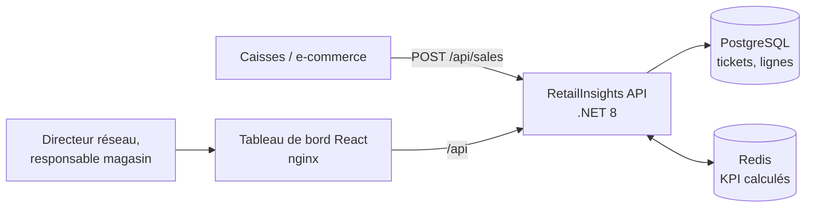
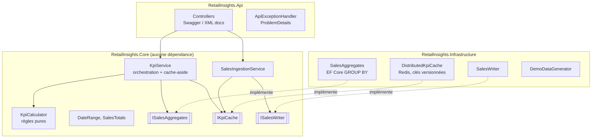
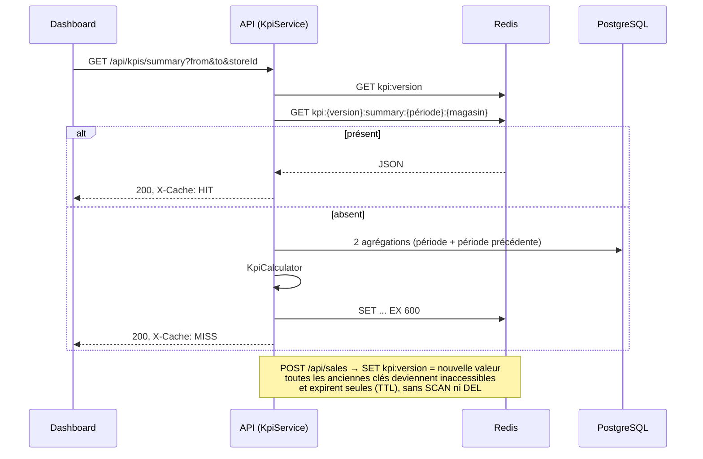
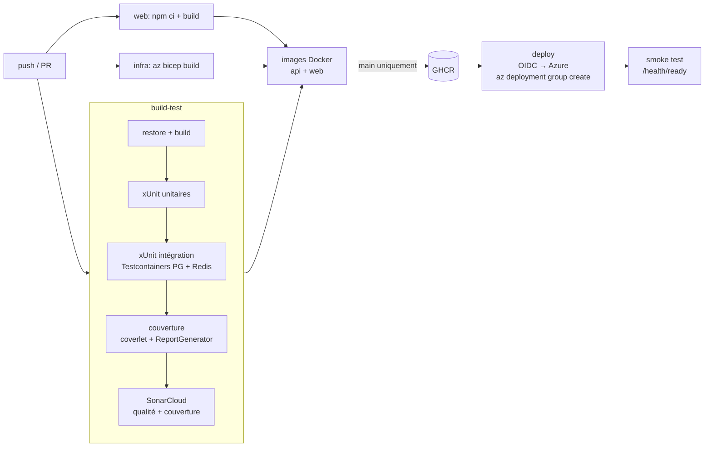
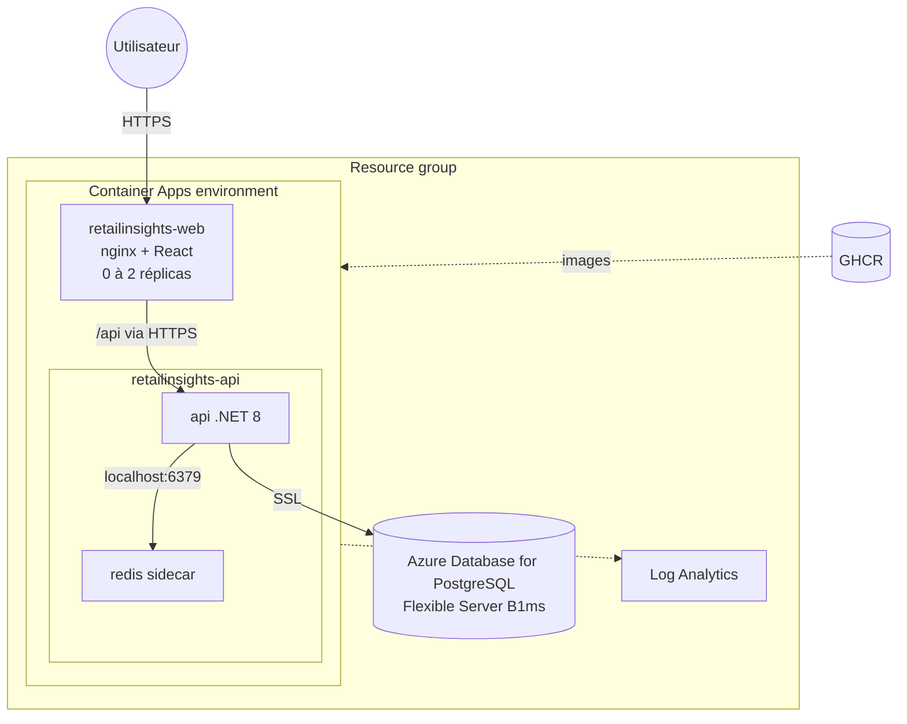

# Architecture de RetailInsights

## 1. Contexte

## 2. Découpage en couches

**Répartition du calcul.** PostgreSQL fait ce qu'il fait le mieux : filtrer sur l'index
`(business_date, store_id)` et agréger (`SUM`, `COUNT`, `GROUP BY`). Aucune ligne de vente
n'est chargée en mémoire. Les ratios (panier moyen, indice de vente, prix moyen), les
évolutions, les parts, les classements et les regroupements par semaine ou par mois sont
calculés dans `KpiCalculator`, du code pur couvert par des tests unitaires.

**Totaux dénormalisés.** Chaque ticket stocke son montant et son nombre d'articles : les KPI
de synthèse, par magasin, par jour et par canal n'ont besoin d'aucune jointure. Seul le top
produits lit les lignes.

## 3. Cache Redis (cache-aside, clés versionnées)

Choix :

- **Clé = type de KPI + période + magasin (+ granularité, classement)** : deux tableaux de bord sur la même vue partagent la même entrée.
- **Invalidation par version** plutôt que par suppression : une seule écriture, O(1), sans parcourir les clés ; les entrées périmées sont libérées par leur TTL et par la politique `allkeys-lru`.
- **TTL de 10 minutes** (configurable `KpiCache:TimeToLive`) : borne la fraîcheur même si une écriture contournait l'API.
- **Repli** : sans chaîne de connexion Redis, un cache mémoire est utilisé (développement local).

## 4. Pipeline CI/CD

- Les pull requests exécutent tout sauf la publication des images et le déploiement.
- SonarCloud s'active dès que `SONAR_TOKEN` (secret) et `SONAR_ORGANIZATION` / `SONAR_PROJECT_KEY` (variables) sont définis.
- Le déploiement s'active dès que les variables Azure sont définies ; l'authentification se fait par **OpenID Connect** (fédération d'identité), aucun secret Azure n'est stocké dans GitHub.
- L'infrastructure est déclarative (Bicep) et redéployée à chaque livraison : le déploiement est idempotent et la nouvelle image crée une nouvelle révision Container Apps.

## 5. Déploiement Azure

- **Redis en sidecar** de l'API : simple et sans coût supplémentaire pour une démo. Le cache est local à la réplica (l'API est fixée à une réplica). Pour monter en charge : Azure Managed Redis, en changeant uniquement `ConnectionStrings__Redis`.
- **Sondes** : liveness sur `/health/live`, readiness sur `/health/ready` (PostgreSQL + Redis).
- **Front** sans URL d'API figée dans le bundle : nginx proxifie `/api` vers l'URL fournie par `API_UPSTREAM`, la même image tourne en local et sur Azure.

## 6. Décisions

| Décision | Alternative écartée | Raison |
|---|---|---|
| Agréger en SQL, dériver en C# | Charger les tickets et calculer en mémoire | Volume : seules quelques lignes agrégées transitent |
| Totaux dénormalisés sur le ticket | Toujours joindre les lignes | Les KPI les plus consultés sans jointure |
| Cache-aside à clés versionnées | Suppression des clés par motif | Invalidation O(1), aucun `SCAN` sur Redis |
| Container Apps | AKS, App Service | Conteneurs sans gestion de cluster, scale-to-zero, révisions |
| OIDC pour Azure | Secret de service principal | Aucun secret longue durée dans GitHub |
